# 01 - Current System Architecture (Diagram 1)

Scope: the "Ireme Insight" district investigation engine as implemented in this repository on 2026-10-29 (commit `919a77e` plus uncommitted Base44-to-Supabase migration edits). Nothing was modified. Items that cannot be established from code or stored artifacts are marked **UNKNOWN**.

## Concise explanation

The "AI engine" is not one service. It is four cooperating layers that run **only on the developer's laptop**:

1. **React UI** (`src/pages/DistrictInvestigation.jsx` and `src/components/investigation/*`) served by Vite.
2. **Vite dev-server middleware** `investigationApi()` in `tools/investigation/vite-api.mjs` (`apply: 'serve'`, localhost-only). This is the only "backend API". It does not exist in a production build (`npm run build` output has no such routes).
3. **Python worker** `tools/investigation/engine.py` (`Investigation` class), spawned as a detached child process per run. It does all statistics, source retrieval, evidence verification, a first LLM call (`ai.review_evidence`) and the PDF/XLSX export.
4. **Node LLM layer** (`llm.mjs`, `ai-report.mjs`, `ai-chat.mjs`, `ai-notebook.mjs`, `web-source.mjs`, ...) that writes the narrative report, answers chat, and summarises uploaded or crawled material. It runs inside the Vite process.

There is **no database, no queue, no cloud worker**. State is JSON files under `investigations/` (git-ignored). Supabase contains only a USSD function and a stand-alone chart-Q&A function; neither calls the engine.

```mermaid
flowchart TB
  subgraph UI["Browser - React (Vite dev)"]
    DI["DistrictInvestigation.jsx - start, poll 1800 ms, resume, review"]
    UAR["useAiReport.js - GET or POST ai-report"]
    RA["ReportArtifact.jsx - report view and downloads"]
    RE["reportExport.js - HTML, Markdown, PDF via html2canvas and jsPDF"]
    CH["InvestigationChat.jsx and Notebook.jsx"]
  end

  subgraph API["Vite middleware vite-api.mjs - localhost only, dev server only"]
    RT["investigationApi routes: run, resume, run-id, result, catalog, report-pdf-xlsx, ai-report, chat, notebook, sources, upload, sites, review, board"]
    WK["workers Map, resuming Set, changing Set - in-memory concurrency guards"]
  end

  subgraph PY["Python worker - tools/investigation/engine.py"]
    ENG["Investigation.run and _run - 8 checkpointed stages, OS file lock, 10 s heartbeat"]
    CAT["catalog.discover - file and variable inventory"]
    SRC["sources.check_sources - 24 registered URLs, 4 threads"]
    STAT["analysis.calculate_eicv7, context, reliability, drivers"]
    FIN["finance.py and finscope2012 2016 2020, trends.py"]
    VER["verification.verify_evidence"]
    RES["results.py, diagnosis.py, brief.py, problem_profile.py, provenance.py"]
    AIPY["ai.review_evidence - LLM reference selector"]
    REP["reports.export_reports - PDF via reportlab, XLSX via xlsxwriter"]
  end

  subgraph NODE["Node LLM layer - inside Vite process"]
    LLM["llm.mjs complete - provider order Groq then NVIDIA"]
    AIR["ai-report.mjs buildDigest, writeAiReport, unmatchedNumbers"]
    TPL["reportTemplate.js assembleReport, reportChecks.js reviewText, reportVerification.js"]
    AIC["ai-chat.mjs answerInvestigationQuestion, validateActions"]
    AIN["ai-notebook.mjs organizeNotebook"]
    WEB["web-source.mjs, site-index.mjs, data-platform.mjs, browser-render.mjs"]
  end

  subgraph DATA["Local data - Data folder"]
    E7["EICV7 2023-24 zip and VUP zip"]
    EH["EICV3-4 panel, EICV4 and EICV5 zips"]
    FS["FinScope 2012 sav, 2016 sav, 2020 zip, 2024 dta"]
  end

  subgraph STORE["investigations folder - JSON files, no database"]
    RUNS["runs by id: manifest, stage JSON 01 to 08, events.jsonl, lease, findings, action-plan, ai-report, chat, investigation.pdf and xlsx"]
    CACHE["cache: catalog by data signature, data-platform catalog, crawled sites"]
    SC["source-cache: NISR PDFs by sha256, text extracts, metadata JSON"]
    TR["trash: deleted runs, recoverable"]
  end

  subgraph EXT["External services"]
    NISR["statistics.gov.rw EICV7 PDFs and HTML pages"]
    OTH["LODA, World Bank API, DHS, WFP, FAO, UNDP, UNICEF, ministries and others"]
    DGR["api.data.gov.rw catalogue"]
    GROQ["Groq - openai/gpt-oss-120b"]
    NV["NVIDIA - nemotron-3-ultra-550b-a55b"]
    ANY["Analyst-supplied websites and uploaded files"]
  end

  subgraph SB["Supabase - NOT connected to the engine"]
    CI["functions/chart-insight - Groq only"]
    US["functions/ussd"]
  end

  DI --> RT
  UAR --> RT
  CH --> RT
  RA --> RE
  RT --> WK
  RT -->|spawn detached child| ENG
  ENG --> CAT --> E7
  CAT --> EH
  CAT --> FS
  ENG --> SRC --> NISR
  SRC --> OTH
  SRC --> SC
  ENG --> STAT --> E7
  ENG --> FIN --> FS
  FIN --> EH
  ENG --> RES
  ENG --> VER
  VER --> SC
  ENG --> AIPY --> GROQ
  AIPY --> NV
  ENG --> REP
  ENG --> RUNS
  CAT --> CACHE
  RT --> AIR
  RT --> AIC
  RT --> AIN
  AIR --> LLM
  AIC --> LLM
  AIN --> LLM
  LLM --> GROQ
  LLM --> NV
  AIR --> TPL
  WEB --> ANY
  WEB --> DGR
  RT --> WEB
  AIR --> RUNS
  RT --> RUNS
  RT --> TR
  CI -.->|separate path, not engine| GROQ
```

## Source files (real paths)

| Layer | Files |
|---|---|
| UI | `src/pages/DistrictInvestigation.jsx`, `src/components/investigation/{useAiReport.js,ReportArtifact.jsx,reportExport.js,VerificationSection.jsx,InvestigationChat.jsx,Notebook.jsx}`, `src/lib/investigationApi.js` |
| API | `tools/investigation/vite-api.mjs` (`investigationApi`, `watchWorker`, `interrupted`, `listHistory`), `vite.config.js` (reads `GROQ_API_KEY`, `NVIDIA_API_KEY`, injects into plugin) |
| Worker | `tools/investigation/engine.py` and the Python modules listed in [09-component-inventory.md](09-component-inventory.md) |
| LLM layer | `tools/investigation/{llm.mjs,ai-report.mjs,ai-chat.mjs,ai-notebook.mjs}`, `src/lib/{reportTemplate.js,reportChecks.js,reportVerification.js}` |
| Data | `Data/Track 2 - Financial Inclusion and Poverty Reduction/` (16 files) |
| Persistence | `investigations/` (ignored by `.gitignore`) |

## Inputs and outputs of the major components

| Component | Input | Output |
|---|---|---|
| `investigationApi` `POST /run` | `{district}` JSON (<=40 000 bytes) | `202 {id,status:'Pending'}` or `200 {reused:true}` |
| `Investigation._run` | district name, `Data/` tree | `investigations/runs/<uuid>/*.json`, `investigation.pdf`, `investigation.xlsx` |
| `writeAiReport` | `08-preparing-findings.json` | `ai-report.json` `{report, model, provider, generated_at, unmatched_numbers}` |
| `answerInvestigationQuestion` | chat messages + findings + passages | `{answer, actions[], cited_sources, unmatched_numbers}` |

## Facts established vs not

* Confirmed in code: `apply: 'serve'` (`vite-api.mjs:~125`), spawn of `python -m tools.investigation.engine` (`vite-api.mjs:216`), no DB client in `tools/investigation`.
* Confirmed by artifact: `investigations/runs/1d3f9adc-.../manifest.json` shows the run executed through all 8 stages.
* **UNKNOWN**: any production hosting plan for the engine. `AGENTS.md` still describes a Base44 app; `base44/` is deleted in the working tree and `src/lib/supabaseClient.js` exists, but no code path routes investigations to Supabase.
* **Ollama**: no integration exists. The only match in the repo is a mention in `docs/EVIDENCE_VERIFICATION.md`; no code calls an Ollama endpoint.
