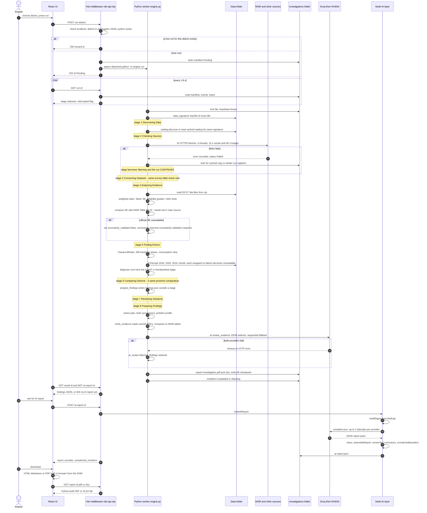

# 02 - Investigation Execution Workflow (Diagram 2)

Sequence reconstructed from `tools/investigation/vite-api.mjs`, `engine.py`, and the stored run `investigations/runs/1d3f9adc-17ba-44ba-b52a-56597f243a69` (Kamonyi, started 2026-10-29T18:55:42Z).

## Entry points and validation

* Start: `POST /__local/investigations/run` with `{district}` (`vite-api.mjs:184-223`).
* Validation at the API: host must be localhost/127.0.0.1/[::1] and Origin must match (`vite-api.mjs:128-132`); body <= 40 000 bytes (`readBody`); `district` must be a `name` in `src/data/dashboard-eicv7-aggregates.json`; `.venv` Python must exist.
* Validation in Python: `Investigation.__init__` requires a UUID id and non-empty district; `calculate_eicv7` raises `Unknown EICV7 district` if the name is not in the poverty file (`analysis.py:83`).
* District selection: one district per run, chosen from a UI list. **Indicator selection does not exist**: the five indicators (poverty, extreme poverty, VUP among poor, grid connection, health insurance) are hard-coded in `analysis.calculate_eicv7`.
* Progress/state: `manifest.json` (stage statuses, counts, warnings, errors), `events.jsonl`, `lease.json` heartbeat every 10 s. The UI polls `GET /run/:id` every 1800 ms (`DistrictInvestigation.jsx:99`). A run is reported "Failed/interrupted" if the heartbeat is older than 120 s (`interrupted()`).
* Concurrency: one live worker per district (`workers` Map); a per-run OS lock (`msvcrt.locking` / `fcntl.flock`) in `Investigation.run`. There is **no global cap** on simultaneous districts.

## Stages that are missing, bypassed or not gating

| Expected stage | Actual behaviour | Evidence |
|---|---|---|
| Hard stop on failed official retrieval | **Bypassed**: stage 2 only emits a Warning (`engine.py:224-227`); stages 3-8 run regardless | Kamonyi run: `20 official sources could not be verified`, run still `Warning`, report produced |
| Validation gate before report generation | **Not implemented**: `verify_evidence` never raises; `summary.unresolved` counts only `discrepancy_requires_review` entries | `verification.py:361-366`; Kamonyi `unresolved: 0` with 10 `not_externally_verified` |
| Independent verification of AI text | **Partial**: wording direction check, causal-word substitutions, non-blocking unmatched-number list | `reportChecks.js`, `ai-report.mjs:88-103` |
| AI provenance in report body | Provider and model stored beside report in `ai-report.json`; not printed in the report | `ai-report.mjs:114` |
| Approval | Not implemented. `POST approve/act/follow-up` return 403 by design; review notes carry "no operational authority" | `vite-api.mjs:511-514`, `:499` |
| Queue / retries of whole run | None. Manual `POST resume` re-enters `_run`; completed stage checkpoints are reused | `engine.py:120-122` |
| `diagnose()` and `prepare_findings()` | Executed outside `self.stage(...)`, so no checkpoint of their own; findings file is reused if present (`engine.py:288-295`) | code |

## Retry / fallback paths that exist

* Source retrieval: conditional GET (`If-None-Match`, `If-Modified-Since`), HTTP 304 revalidation of cached hash, fallback to `cached_evidence` from earlier run registers (`sources.py:130-208`).
* LLM: one retry after a short 429 (<=30 s) unless the message mentions daily limits; JSON requests get one extra attempt on parse failure; then next provider (`ai.py:65-80`, `llm.mjs:61-77`).
* Stage-level: a failed stage records `Failed` and the run stops; resume skips `Completed`/`Warning` stages that have checkpoints.
* Optional analyses (FinScope 2024/2020/2016, trends) are individually wrapped in try/except and become `{"status":"Unavailable"}` (`engine.py:261-284`).

## Uncertainties

* UNKNOWN whether the UI ever auto-triggers `POST ai-report`; the hook only GETs the cached report (`useAiReport.js`), so generation requires an analyst action. The Kamonyi `ai-report.json` was generated at 19:10:35Z, about 9 minutes after the run ended.
* The Python worker is spawned with `stdio: 'ignore'`; stdout/stderr are discarded. Only `events.jsonl` and `manifest.json` capture runtime history.
