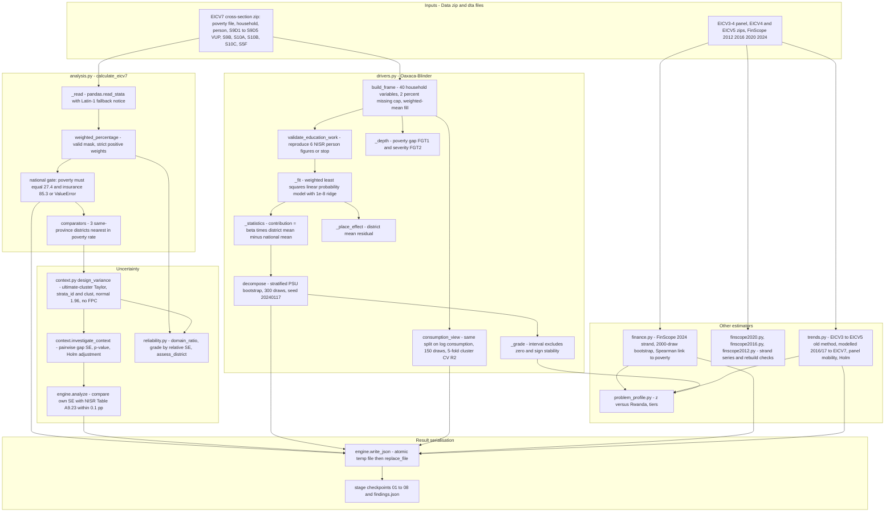

# 03 - Statistical Analysis Architecture (Diagram 3)

All statistics are Python (pandas/numpy, no `statsmodels`, no `scipy`, no survey package such as R `survey`/`samplics`). Every figure below was read from code; stored Kamonyi values come from `investigations/runs/1d3f9adc-.../08-preparing-findings.json`.

## What is actually implemented (confirmed in code)

| Topic | Implementation | Location |
|---|---|---|
| Headcount | Weighted share of `pov_jan == "Poor"` using `pop_wt` (person-level weight), rounded to 0.1 | `analysis.weighted_percentage`, `analysis.py:25-37`, call `:95-96` |
| Extreme poverty | Same with `epov_jan == "Extreme Poor"` | `analysis.py:96` |
| VUP among poor | Household-weighted (`weight`) share of poor households with any `s9d1q1 == "Yes"` across five S9D modules | `analysis.py:69-85, :97` |
| Grid connection | Household-weighted share of `s5cq14` in {"Yes on grid", "Yes both on grid  and from solar"}; denominator includes "Yes from solar" and "No"; other answers dropped | `analysis.py:92, :98` |
| Poverty gap / severity | `fgt1=(line-sol_jan)/line` clipped at 0, `fgt2=fgt1**2`, weighted by `pop_wt`; code first checks `sol_jan < Poverty_line` reproduces NISR's Poor flag for every household | `drivers.build_frame:224-232`, `_depth:610-626` |
| Survey weights | Rejects NaN/non-finite/<=0 weights (`ValueError`), no trimming, no calibration | `analysis.py:28-30`, `reliability.domain_ratio:20-22` |
| Standard errors | Ultimate-cluster Taylor linearisation by `strata_id` x `clust`; singleton strata raise `ValueError` (no lonely-PSU rule); normal 1.96 CI; no finite-population correction | `context.design_variance:7-15`, `reliability.domain_ratio` |
| Gap tests vs comparators | Difference of influence functions, two-sided normal p, Holm adjustment over 3 tests | `context.investigate_context:61-77` |
| District vs national | Rate difference and descriptive text; national value is `rate over all households`, with the district included | `results.prepare_findings` |
| Oaxaca-Blinder | Pooled national WLS LPM of `poor` on 40 variables (+ intercept). `contribution_k = beta_k * (mean_district_k - mean_national_k)`. Groups of variables summed; unexplained = gap - explained. One reference coefficient vector (all Rwanda, district included) | `drivers._fit`, `_statistics`, `decompose:458-583` |
| Bootstrap | Resample PSUs within stratum with replacement, **refit model each replicate**, 300 replicates (150 for consumption view), fixed `SEED=20240117`, percentile 2.5/97.5 | `drivers.decompose:473-489`, `consumption_view:400-409` |
| Reliability grade | `n<30` -> Suppressed; RSE>30% Low; >15% Use with caution; else Reliable. Labelled "application rule, not an NISR standard" | `reliability.grade:33-39, RULE` |
| Driver grade | `Not established` unless interval excludes zero and sign stability >= 0.9; markers capped at "Moderate - sign of deprivation"; "Strong" needs >=1.0 pt and stability >= 0.95 | `drivers._grade:328-334` |
| Missing data | Driver variables: >2% missing stops the run; otherwise filled with national weighted mean and counted in `model.missing_values_filled`. Headline indicators: invalid answers excluded from denominator | `drivers.py:281-290`, `analysis.py:91-92` |
| Historical trend analysis | EICV3-EICV5 rounds read from `.sav` zips; modelled 2016/17 comparison read from NISR PDF annex; EICV3-EICV4 panel | `trends.py` (`load_rounds`, `old_series`, `new_series`, `panel_mobility`) |
| Financial inclusion | FinScope 2024 `.dta` access strand rebuilt from `qf1_*`/`qf4_*`; 2020 and 2016 use NISR strand variable; 2012 rebuilt; association with poverty = district Spearman rank | `finance.py`, `finscope2020.py`, `finscope2016.py`, `finscope2012.py` |
| Statistical validation | (a) national reconciliation to hard-coded 27.4 / 85.3; (b) 6 NISR person figures reproduced; (c) SE vs NISR A9.23; (d) `methods_review` arithmetic checks; (e) unit tests with planted drivers | `analysis.py:117`, `drivers.validate_education_work`, `engine.py:246`, `verification.methods_review`, `test_investigation.py` |

## Not implemented (do not assume from reports)

* **Design effects / replicate weights / linearisation for the decomposition**: the point estimate uses weights only; the intervals come from the PSU bootstrap. No finite-population correction anywhere.
* **Bootstrap of headline rates**: headline rates use Taylor SE only; the bootstrap applies to the decomposition and consumption view.
* **Poverty line construction**: uses NISR's supplied `Poverty_line`, `sol_jan`, `pov_jan`; engine does not rebuild consumption aggregates. (`docs/EICV4_EXPENDITURE_REPAIR.md` documents a separate EICV4 repair note; it is not engine code.)
* **Logistic or nonlinear decomposition, interaction terms**: only LPM, stated as an assumption in `verification.methods_review`.
* **Multiple reference groups for Oaxaca**: only the pooled national coefficients; `methods_review.assumptions` states the sensitivity but the code does not test it.

## Dependencies between modules

`engine.py` -> `analysis.py` -> `context.py` + `reliability.py` (`reliability` imports `context.design_variance`). `drivers.py` imports `analysis.{HOUSEHOLD,PERSON,POVERTY,_read}`. `trends.py`, `finscope2020.py` (imports `finance`), `finscope2016.py` and `finscope2012.py` (import `finance`) are independent of `analysis.py` for estimation. `problem_profile.py` consumes `analysis`, `drivers`, `diagnosis`, `finance`, `trends` outputs only.

## Stored Kamonyi values (see [11-kamonyi-execution-trace.md](11-kamonyi-execution-trace.md))

Poverty 39.7 (n=484 households per `district_sample_households`), national 27.4, gap 12.32 pp (CI 5.84 to 19.18), explained 4.52, unexplained 7.80, `weighted_r_squared` 0.254, explained-excluding-markers 3.11 pp (25.2%).

## Uncertainties

* UNKNOWN whether the Taylor SE for non-poverty indicators (VUP, grid, insurance) agrees with NISR; only the poverty SE has an official comparison (`engine.py:243-249`), and it needs the NISR PDF to be retrievable. In the Kamonyi run it was not (`uncertainty_validated: false`).
* A one-off independent recomputation of all 30 district poverty rates exists at `docs/audits/nisr-judging-2026-10-29/independent-poverty.json` (all 30 match, national 27.4). It is an audit artifact, not part of the runtime engine, and covers only the poverty flag.
