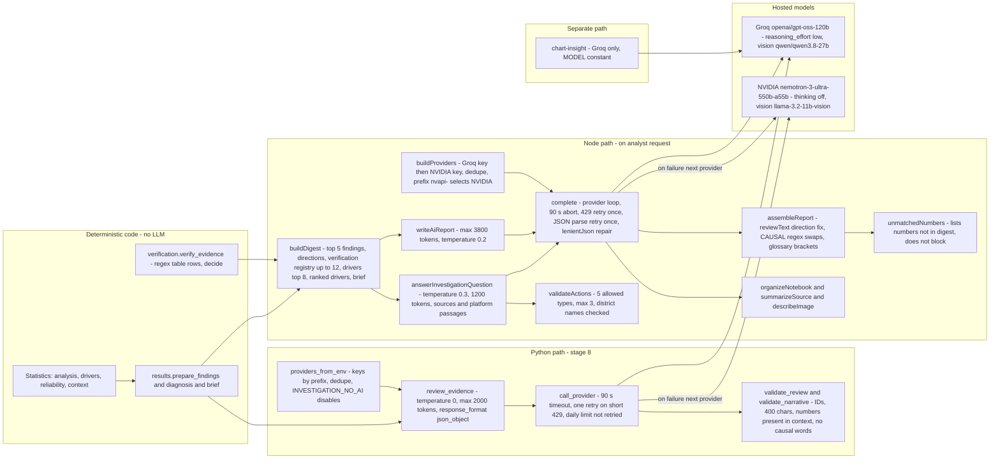

# 04 - AI Model and Agent Architecture (Diagram 4)

## Concise explanation

There are **no autonomous agents and no tool-calling loops**. The system makes single-shot chat-completion calls to OpenAI-compatible endpoints from two code bases (Python and Node) that duplicate the provider logic. Each call site has a different job and a different (non-uniform) validator:

| # | Call site | Language | Purpose | Output validated by |
|---|---|---|---|---|
| A | `ai.review_evidence` (`ai.py:164`) in stage 8 | Python | Select/ordering of existing finding IDs, research options, question IDs, plus optional <=6 narrative sentences | `validate_review` + `validate_narrative`: IDs must exist; sentence <=400 chars; must cite known finding IDs; **every number must exist somewhere in the supplied context**; causal words rejected (`CAUSAL` regex). Bad sentences dropped individually. |
| B | `writeAiReport` (`ai-report.mjs:105`) | Node | Full narrative report JSON | `clean()` length/shape limits -> `assembleReport` (`reviewText`, glossary) -> `unmatchedNumbers` (non-blocking list) |
| C | `answerInvestigationQuestion` (`ai-chat.mjs:94`) | Node | Chat answers + proposed "actions" | `validateActions` allowlist (5 action types, max 3); `unmatchedNumbers` non-blocking |
| D | `organizeNotebook` (`ai-notebook.mjs`) | Node | Summarises chat/review history | `unmatchedNumbers` non-blocking |
| E | `summarizeSource`, `describeImage` (`web-source.mjs`, `llm.mjs`) | Node | Summaries of uploaded files, web pages; vision text | none (third-party material, labelled as such to later prompts) |
| F | `answerChartQuestion` (`supabase/functions/chart-insight/groq.mjs`) | Node/Deno | Dashboard chart Q&A | none; Groq only, 20 s timeout, single model |
| G | `check_ai.py` | Python | Key health check ("Reply with OK") | n/a |

Nothing in the AI stack calculates statistics or verifies evidence. **Verification (`verification.py`) contains no LLM call**.

## Providers, models, keys

* **Providers**: Groq (`https://api.groq.com/openai/v1/chat/completions`) and NVIDIA (`https://integrate.api.nvidia.com/v1/chat/completions`). Constants duplicated in `ai.py:25-26` and `llm.mjs:3-4`. The Python copy has no vision model.
* **Ollama**: **not integrated** (no code reference).
* **Models** (hard-coded): Groq `openai/gpt-oss-120b`; NVIDIA `nvidia/nemotron-3-ultra-550b-a55b`; vision `qwen/qwen3.8-27b` (Groq) and `meta/llama-3.2-11b-vision-instruct` (NVIDIA). No configuration file or env override of model names. `validate_review` hard-codes `"model": "openai/gpt-oss-120b"` and then the caller overwrites it with the provider's model (`ai.py:160, :204`).
* **Key handling**: `GROQ_API_KEY`, `NVIDIA_API_KEY` from env or `.env.local`; `vite.config.js` loads them for Node; the Python child receives `GROQ_API_KEY` via spawn env and reads `.env.local` for both (`ai.load_env_file`). Keys are classified by prefix `nvapi-`. Identical keys are used once. **No API key rotation**: at most one key per provider; "fallback" is Groq -> NVIDIA in that order. A daily-limit 429 is not retried and is reported to the user. Secrets are never written to results (`ai.py` comment; error handler stores only provider name and status).
* **Timeouts/retries**: 90 s per request; one retry after Retry-After <= 30 s; JSON mode retries once per provider on malformed JSON (Node only). Worst-case latency observed: Kamonyi stage-8 AI review consumed 127 s and ended with both providers failing (`events.jsonl` 18:59:30 to 19:01:37Z).

## Prompts and context assembly

* **Python reviewer** system prompt (`ai.py:192`): treat source text as untrusted, return only JSON with `finding_ids`, `option_titles`, `question_ids`, optional `narrative`; "never compute differences, ratios or sums yourself". User message = JSON of findings subset, source conflicts, research option titles, district context (profiles removed), reliability, not-analysed list, financial access/trend/series, problem profile (tiers).
* **Report writer** `SYSTEM` (`ai-report.mjs:36-65`): use only digest figures; follow `direction_versus_rwanda`; "never say a figure was verified unless its status is verified_match"; fifteen-year-old reading level; exact JSON keys. The digest (`buildDigest:13-34`) contains findings, directions, verification entries (<=12, notes truncated to 110 chars), comparison poverty, analyst brief, drivers, ranked drivers, research requests, response options. **It does not include the reliability grades or `ReliabilityEvidence` data even though the prompt tells the model to use "the reliability grades"** (only driver-group `grade` is included). Published CIs are included only if a published interval exists (`ci95_text`).
* **Chat** `SYSTEM` (`ai-chat.mjs:10-34`): many untrusted-source rules and action grammar; context = digest + all-district table + optional programme findings, delivery text, site passages `[W]`, data platform passages `[P]`, attached files `[S]`.
* Verification statuses reach the LLM only as text; compliance with "never say verified" is **prompt-enforced only**; code does not check it.

## How AI statements are validated and "corrected"

1. Python reviewer: exact-number membership, ID membership, causal regex (`ai.py:98-125`). Only the reviewer's output is checked this strictly.
2. Report writer: `clean()` enforces lengths and structure and refuses reports missing title/objective/background/interpretation/conclusion/main points/sections (`ai-report.mjs:82-83`).
3. `assembleReport` (`reportTemplate.js:122`) passes every text through `reviewText` (`reportChecks.js:98`): (a) `directionProblems` regex classifier of "above/below the national figure"; offending sentences are **replaced** by `describeFacts()` text built from `verification.directions`; (b) `CAUSAL` list swaps phrases such as "caused by" -> "associated with"; (c) `tidyDecimals`. Each change is recorded in `report.verification.corrections` and shown in section 5.
4. `unmatchedNumbers` (`ai-report.mjs:88-103`) lists numbers (ignoring <=12, 100 and years 19xx/20xx) that are not in the digest; the UI shows an amber footnote (`ReportArtifact.jsx:53`). It does not block, remove, or alter the report.
5. Chat actions: `validateActions` allowlist; the UI requires analyst confirmation before running any action; `POST approve/act/follow-up` are disabled server-side (403).

### Correction can introduce an error (demonstrated)

The Kamonyi sentence "Just 9.2% of poor households report participation in a VUP component, lower than the national 15.9%." was **true**. `mentionsIn()` matched both `vup_among_poor` and `poverty` (pattern `/poverty|\bpoor (?:people|households)\b/`, because of "poor households"), so the poverty fact (39.7 above 27.4) was judged contradicted by "lower than the national", and the whole sentence was replaced by a two-claim sentence containing an unrelated poverty statement. I reproduced this offline with `reviewText()` on the stored facts (see [11-kamonyi-execution-trace.md](11-kamonyi-execution-trace.md)). The stored output also leaves a capitalised clause after a semicolon ("; The poverty rate...").

## Uncertainties

* UNKNOWN which provider produced the Kamonyi Python review: it failed with timeouts for both. The AI report was produced by Groq `openai/gpt-oss-120b` (`ai-report.json`).
* UNKNOWN token counts, cost, and prompt text actually sent: requests/responses are not logged by design; only provider/model are stored.
