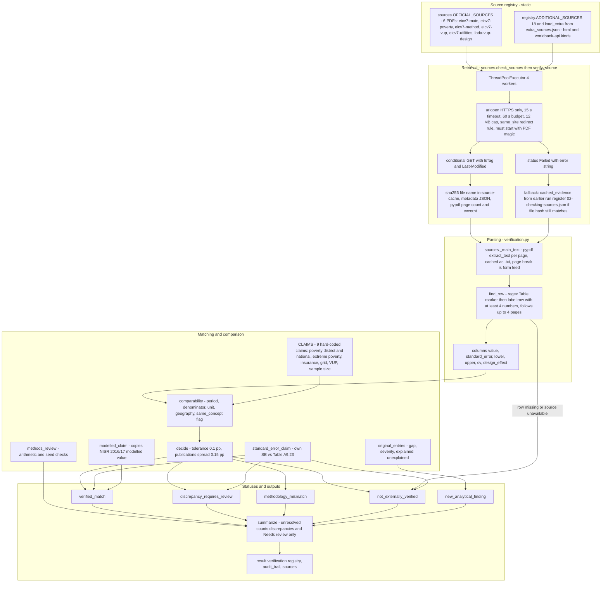

# 05 - Official Evidence Verification Architecture (Diagram 5)

## Concise explanation

"Verification" is a deterministic, regex-based comparison of the engine's own computed numbers with rows of NISR PDF tables. **No AI participates in discovery, extraction, matching or status assignment.** The LLM later receives the resulting statuses as text. Publications are not "discovered": they come from a static allow-list of URLs.

## How each requested question is answered

| Question | Answer from code |
|---|---|
| Discovery | **None.** URLs are literals in `sources.py:19-68` and `registry.py:30-195`; analysts may add sources through `extra_sources.json` (`load_extra`) or, separately, add web pages/uploads to the chat (those never enter `verification.py`). |
| URL storage | Python dict literals; `original_url`, `final_url`, `version` (sha256), `retrieved_at`, `etag`, `last_modified` recorded per run in `02-checking-sources.json` and per source in `investigations/source-cache/<id>.json`. |
| PDF/Excel retrieval | `verify_source` handles `kind` `pdf` (default), `html`, `worldbank-api`. **Excel retrieval is not implemented** in the registry/verification path (xlsx is only supported for uploads and catalogue reading). |
| Caching | Yes: PDFs by `<id>-<sha256[:12]>.pdf` plus `.txt` text cache and `<id>.json` metadata in `investigations/source-cache/`. A conditional GET is attempted only if the metadata file has the same URL and `Completed` state. |
| Tables/figures extraction | Text-layer regex only (`find_row`, `published_poverty_intervals`, `published_modelled_comparison`). **No OCR, no figure/chart extraction, no table-structure parser.** Page numbers: PDF index plus printed number heuristic (`printed_page`). |
| Indicator matching | Static `CLAIMS` list ties each internal key to (`source`, `table`, `row` = district name or "Rwanda"). `same_concept: False` is declared by hand for grid electricity (A5.14 and B.7 measure lighting source, not grid connection). |
| Comparison | `decide()`: any comparability issue -> `methodology_mismatch`; otherwise \|internal-published\| <= 0.1 -> `verified_match`, else `discrepancy_requires_review`; no candidates -> `not_externally_verified`. The engine never overwrites its value. |
| Status assignment | `verification.py:14-19` constants; `summarize()` computes `unresolved = discrepancies + (1 if decomposition Needs review)`. |
| Failure handling | Source unavailable -> note "could not be retrieved (error), so this claim was not verified" and `not_externally_verified`; unreadable PDF or missing row -> same. Whole module exception -> `{"status":"Unavailable", ...}` (`engine.py:317-322`). |
| AI involvement | None in verification. AI only reads statuses via `buildDigest` and is told in prose not to say "verified" except for `verified_match`. |

## Weaknesses visible in this architecture (details in [10](10-architectural-weaknesses.md))

* **Circular "verified_match"**: `modelled_claim` sets `internal_value = published_value = row["earlier_modelled"]` and `difference = 0.0` (`verification.py:289-292`). It is a copy, labelled as such in the notes, but it counts toward "N of M match".
* **Equivalent definitions**: only a hand-written flag decides equivalence. VUP has `published: []` (never checkable); grid electricity can never reach `verified_match` because both candidate tables are flagged different concepts.
* **Fallback gap**: the cached-copy fallback searches `investigations/runs/*/02-checking-sources.json` (`sources.py:194`), not the per-source metadata file it reads at `:128`. In the audited run `eicv7-main` had a valid hash-addressable PDF and `.txt` in `source-cache` (retrieved 2026-10-25) but `cached_evidence` was `None`. Whether earlier run registers existed when that run started is **UNKNOWN** (117 deleted runs sit in `investigations/trash/`, excluded from the search by design).
* **Parsing brittleness**: `find_row` expects `label` followed only by numbers on a single line; PDF text-extraction layout changes silently produce "no row" and therefore `not_externally_verified`, indistinguishable at the headline level from "not published".

## Uncertainties

* UNKNOWN: whether the other 18 "additional" sources were ever retrieved successfully in practice. In the audited run only `loda-vup-design`, `eicv7-poverty`, `eicv7-vup`, `worldbank-wdi` completed.
* UNKNOWN: row-extraction success rate on the current `eicv7-main` PDF at audit time; `tools/investigation/test_verification.py` (27 tests, all passing when run during this audit) mixes synthetic text with `RusiziRegressionTests`, which reads the real cached NISR PDFs from `investigations/source-cache` for hand-typed Rusizi values and is skipped if those files are absent. It shows that when the PDFs *are* cached, district/national poverty and insurance can reach `verified_match`; it does not exercise Kamonyi.
