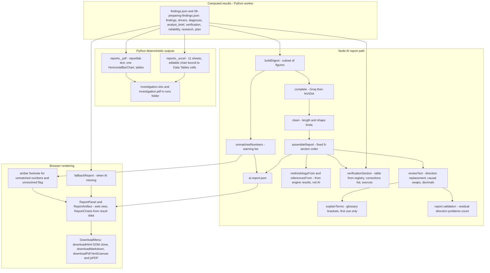

# 06 - Report Generation Architecture (Diagram 6)

## Concise explanation

Three **independent** report builders exist. They read the same findings JSON but do not share a template, and only one of them contains the AI narrative or the evidence-verification section:

| Output | Built by | Where it runs | Contains AI text? | Contains verification section? |
|---|---|---|---|---|
| `investigation.pdf`, `investigation.xlsx` | `reports.export_reports` (`_pdf` reportlab, `_excel` xlsxwriter) | Python worker, end of stage 8 | **No** (all text comes from `analyst_brief`, `findings`, `diagnosis` code) | **No** (`reports.py` never reads `verification`) |
| AI report (structured JSON, eight sections) | `writeAiReport` -> `assembleReport` | Node, on analyst request | Yes (title, objective, main points, sections, risks, conclusion...) | Yes (`verificationSection`, generated from registry, not AI) |
| HTML / Markdown / PDF downloads of the AI (or fallback) report | `reportExport.js` from the rendered DOM | Browser | same as the on-screen report | same |

When no AI report exists or the AI is unavailable, `fallbackReport()` (`reportData.js`) builds the same eight-part layout from engine text and `assembleReport`.

## Where do figures come from?

* **Computed numbers**: every number in the Python PDF/XLSX and in `key_numbers`/verification tables is read from computed JSON (`prepared["findings"]`, `analysis["selected"]`, `drivers`). `reports.py` uses f-strings over those values.
* **LLM-generated text**: the AI report's `executive_summary`, `introduction.background`, `results.sections[].body`, `discussion`, `conclusion`, `options`, `next_steps`. Figures inside this prose are *typed by the model*; the code compares them with the digest only afterwards (`unmatchedNumbers`) and only warns.
* **Cached outputs**: `ai-report.json` is reused until the analyst regenerates; changing underlying findings (resume/rerun) does not invalidate it automatically (no link between `08-preparing-findings.json` hash and `ai-report.json`) - UNKNOWN if the UI warns about staleness beyond `generated_at`.
* **Charts**: web charts (`ReportCharts.jsx`) bind to `result.findings`, `comparison`, `drivers`, `depth` data; the XLSX chart references the Data Tables sheet; the PDF has one reportlab bar chart of poverty.
* **Citations/references**: `referencesFrom` selects register entries whose id matches `^eicv7|^nisr-eicv7` or `loda-vup-design` and that have title + url - **even if the retrieval of that source failed** (it only checks fields, not status).
* **Executive summary**: `main_points` come from the model; `executive_summary.evidence_check` text is composed by code from `verificationSection` (`reportTemplate.js:143-145`).
* **Recommendations**: `research.options` (code, `results.research_options`) and `conclusion.options` (model, "only from supplied response_options or ranked_drivers" - prompt-enforced). No recommendation is authorised: `draft_action_plan` sets `proposed_intervention: None`, `approval_status: "Draft"`.

## Quality checks and approval conditions

* `report.validation = {direction_problems, corrections}` and `readability` (mean sentence length) are *informational*.
* The DownloadMenu receives a `warning` prop when `verification.unresolved > 0`, which is a warning banner only (`ReportArtifact.jsx:60`, `VerificationSection.jsx:25`). Nothing prevents export or publication.
* `unresolved` counts only `discrepancy_requires_review` and a failed decomposition review; it does **not** count `not_externally_verified`. In the Kamonyi report `unresolved = 0` while 10 of 15 claims were unverified and 20 of 24 sources failed to load.
* No human sign-off state, no immutable report version store. Output storage = plain files under `investigations/runs/<id>/`; `ai-report.json` is overwritten on regeneration (`atomicJson`, `vite-api.mjs:317`).

## Failure handling in report generation

* `writeAiReport` errors -> HTTP 500 `{error}`; UI shows an error state; `fallbackReport` is available.
* `clean()` throws `The AI returned an incomplete report.` when required keys are missing.
* Python exports: any exception inside `prepare()` fails stage 8 (`Failed`), run `Failed`, resume possible. **UNKNOWN** if partial PDF/XLSX files can be left from a failed export (writes go directly to the final filename, not atomic temp files, in `reports.py`).

## Uncertainties

* The browser-built PDF is a raster of DOM blocks (html2canvas), so text is not selectable; PDF fidelity vs the on-screen report was not tested here.
* `ReportCharts.jsx` internals were not traced line by line; statements about chart data binding rely on the props named in `ReportArtifact.jsx` and `reportTemplate.js` (`chart` keys `findings|comparison|drivers|depth`).
