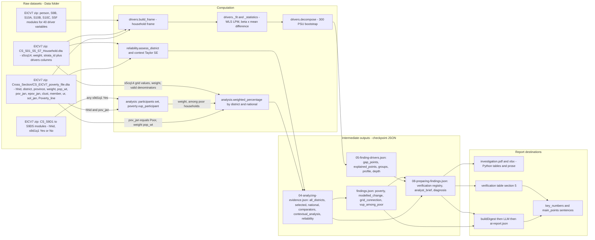

# 07 - Data Lineage Architecture (Diagram 7)

Five indicators traced from raw data to published statements, using the stored Kamonyi run for concrete values. `UNKNOWN` = not determinable from code or artifacts.

## Lineage table

| # | Indicator (Kamonyi value) | Raw source and variables | Transformation / function | Intermediate | Published statements |
|---|---|---|---|---|---|
| 1 | **District poverty rate 39.7%** | `CS_EICV7_poverty_file.dta`: `district`, `pov_jan`, `pop_wt` | `weighted_percentage(group, group.pov_jan == "Poor", "pop_wt")` (`analysis.py:95`); rounded to 0.1 | `04-analyzing-evidence.json` `selected.poverty`; `findings.json` finding `poverty` (`results.py:20-30`) | PDF/XLSX tables (`reports.py`); verification claim `poverty_headcount` (NISR Table A9.23) -> `not_externally_verified` in this run; digest `value_pct`; key number "Poverty rate (people) 39.7%"; main point 1 |
| 2 | **National poverty rate 27.4%** | same file, all rows | `weighted_percentage(poverty, ..., "pop_wt")` (`analysis.py:109`); **hard gate** `!= 27.4` -> `ValueError` (`:117`) | `national.poverty`; reconciled in `reliability.national_reconciliation` | finding comparator, `verification` claim `poverty_headcount_national` (Table 9.1) -> not verified here; text "above the national rate of 27.4%" |
| 3 | **Electricity (grid) 29.1%** | `CS_S01_S5_S7_Household.dta`: `s5cq14`, `weight` | numerator {"Yes on grid", "Yes both on grid  and from solar"}; denominator adds "Yes from solar" and "No"; `weighted_percentage(..., "weight", grid_valid)` (`analysis.py:92,98`) | `selected.grid_connection`; finding `grid_connection` only because \|29.1-50.8\| >= 5 (`results.py:48-49`); reliability entry "Grid electricity connection" (Reliable) | `verification` claim compares to NISR A5.14/B.7 (lighting source) -> by design `methodology_mismatch` when readable; digest, key number, main point "far below the national 50.8%" |
| 4 | **VUP participation 9.2%** | `CS_S9D1..S9D5` `hhid`, `s9d1q1`; poverty file `pov_jan`, `weight` | participants = households with any "Yes"; among `pov_jan == "Poor"` households `weighted_percentage(poor, poor.vup_participant, "weight")` (`analysis.py:69-85,97`) | `selected.vup_among_poor`; finding `vup_among_poor` (always included, `results.py:60-69`); `sample_poor_households` | claim `vup_among_poor` has `published: []`, so always `not_externally_verified`; source of "9.2% below 15.9%" sentence later "corrected"; research option "Review existing VUP delivery" |
| 5 | **Oaxaca-Blinder factor contribution** (e.g. durables +2.10, livelihood +0.98, finance +0.69, energy +0.53 points) | poverty file + household + person + S9B/S10A/S10B/S10C/S5F modules via `build_frame` | WLS LPM `_fit`, `contribution = beta x (mean_d - mean_n)` grouped by `GROUPS`; bootstrap CI; `_grade` | `05-finding-drivers.json` groups, `profile`, `depth`; `diagnosis.ranked_drivers` (`diagnosis.py`), `original_entries` (`gap_explained_points` 4.52, `gap_unexplained_points` 7.80), `methods_review` | digest `drivers.groups` (top 8 by magnitude), AI sentence "each explain part of Kamonyi's poverty gap"; verification section lists decomposition as `new_analytical_finding`; XLSX "Drivers" and "Who Is Poor" sheets; PDF driver table |

## Cross-checks on lineage integrity (code)

* Household IDs must be unique and equal across poverty, household and VUP modules; district labels must agree across modules (`analysis.py:59-67,72-81`).
* The driver frame requires the person-level household size to equal `member` and one recorded head per household (`drivers.py:208-216`).
* Excluded rows are not silently dropped: invalid or "Don't know" responses are excluded from denominators by design (documented in `method`).
* **Not traceable**: the original raw-file hash in the final report text. The report states the `data_signature` only in the manifest/Excel summary; the AI report/HTML does not print dataset hashes. Row-level lineage (which households) is intentionally absent ("aggregate-only").

## Uncertainties

* UNKNOWN: values from `Poverty_line`/`sol_jan` construction (supplied by NISR, not recomputed).
* UNKNOWN: how NISR derived `pop_wt` and `strata_id`; the engine trusts them.
