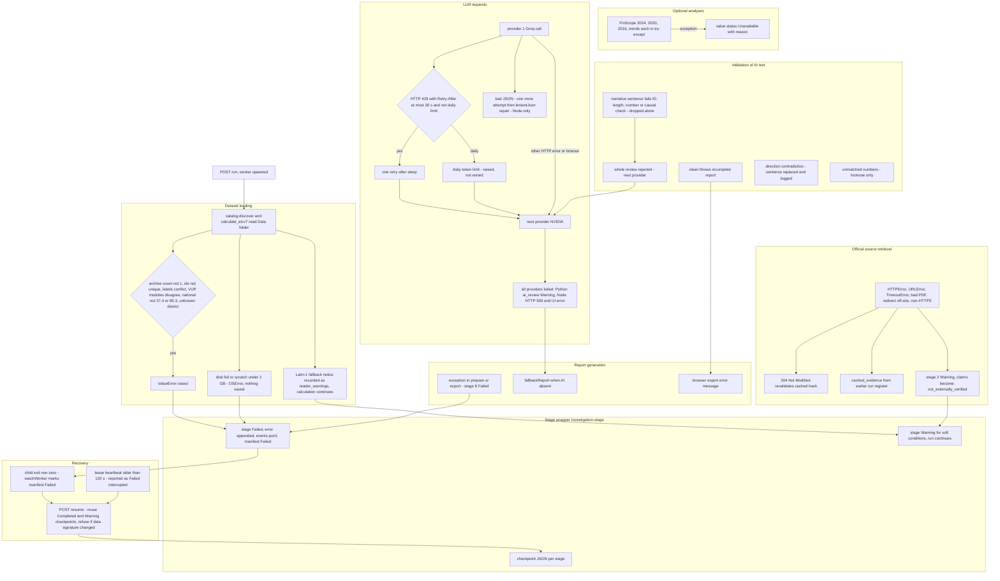

# 08 - Error Handling and Recovery (Diagram 8)

Only handling that exists in code is drawn. Anything not shown is **not implemented** (for example automatic retry of a whole run, alerting, circuit breakers, dead-letter handling, report-blocking on unverified evidence).

## Handling by failure class (with locations)

| Failure | Behaviour | Code |
|---|---|---|
| Dataset load / structural validation | `ValueError` -> stage `Failed`; run `Failed`; process exit code 1; manifest preserves checkpoints | `engine.stage:137-144`, `Investigation.run:178-182`, `main:387-389` |
| Stata encoding | `UnicodeWarning` recorded, run continues, note added to stage 4 | `analysis._read:40-46`, `engine.py:257-259` |
| Low disk | `check_scratch_space(2 GB)`, `disk_full_tables`; `OSError` "Nothing was saved" | `catalog.py:47-62`, `engine.py:213-217` |
| Data changed on resume | `ValueError` forces a new investigation | `engine.py:190-191` |
| Statistical failures | Validation errors raise (weights, singleton stratum, missing >2%, definitions not reproducing NISR). Optional analyses degrade to `Unavailable` | `analysis.py:28-30`, `context.py:11-13`, `drivers.py:281-285`, `engine.py:261-284` |
| Uncertainty not reconciled | Warning; text conclusions switched to "Uncertainty validation required" | `engine.py:246-256` |
| Source retrieval | per-source error captured; conditional GET + 304; fallback to earlier-run cached evidence; stage 2 is a Warning | `sources.py:113-210`, `engine.py:224-227` |
| Verification module crash | `{status:"Unavailable"}`; report says no claim was checked | `engine.py:317-322`, `reportVerification.js:37-43` |
| LLM failure | provider fallback; `ai_review` Warning with reason string; Node 500 | `ai.py:196-214`, `llm.mjs:61-77`, `vite-api.mjs:516-518` |
| Rate limit | single short wait retry; daily limit not retried | `ai.py:65-80`, `llm.mjs:44-53` |
| Validation failure (AI) | drop sentence; reject review -> next provider; report incomplete -> error | `ai.py:98-161`, `ai-report.mjs:82-83` |
| Worker death | lease heartbeat stale >120 s -> shown as Failed/interrupted; exit != 0 -> manifest set Failed; resume available | `vite-api.mjs:38-59` |
| Delete protection | busy runs cannot be deleted; deleted runs moved to `investigations/trash` | `vite-api.mjs:149-182` |
| API robustness | uniform `try/catch` -> 500 JSON; request size caps (40 KB JSON, 12 MB upload) | `vite-api.mjs:516-518,75-106` |

## Not handled / worth noting

* **No automatic resume or restart**: a failed run waits for a manual `POST resume`.
* **Source failures do not stop the run** and are not surfaced in the report headline beyond "N of M figures match NISR's published tables".
* **Worker output discarded** (`stdio: 'ignore'`): uncaught Python exceptions outside `Investigation.run` are not logged anywhere besides the generic watcher message.
* **Python PDF/XLSX writes are not atomic**; manifests/checkpoints are (`write_json` temp file + `replace_file`).
* **No timeout on the whole stage 8**; each LLM call can take up to ~90 s x 2 attempts x 2 providers (observed 127 s in the Kamonyi run).
* UNKNOWN: behaviour when two Vite processes share one `investigations/` folder (the in-memory `workers` map is per process; the OS lock protects only the same run id).
