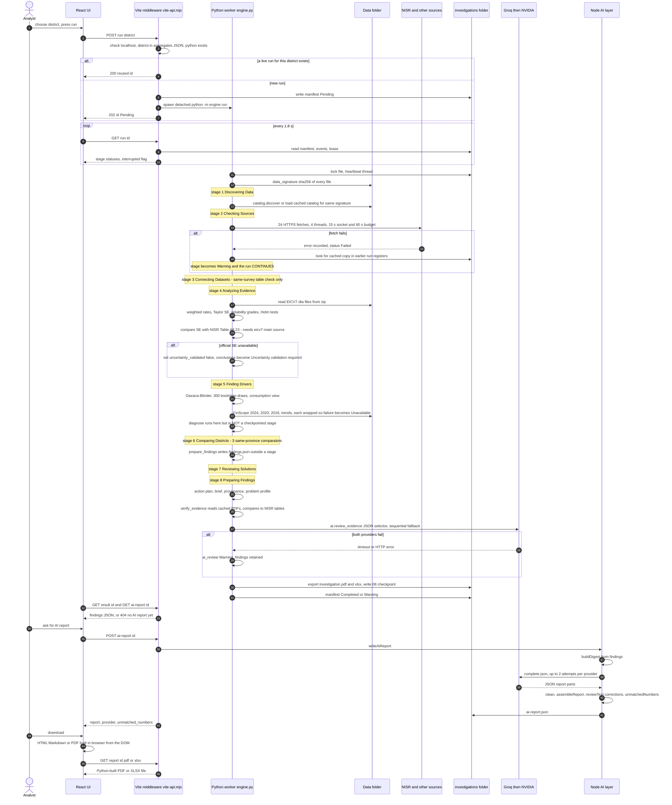
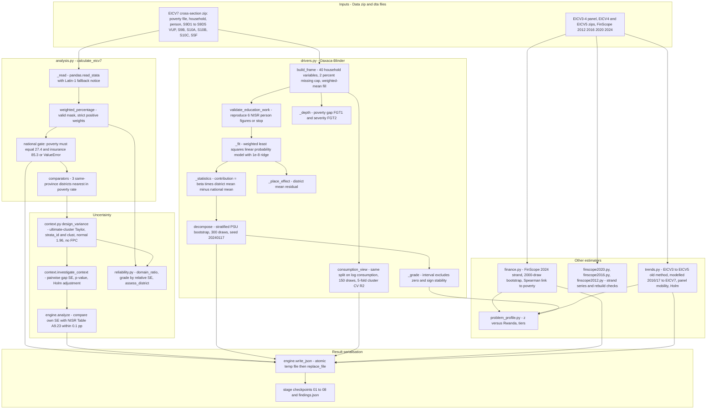
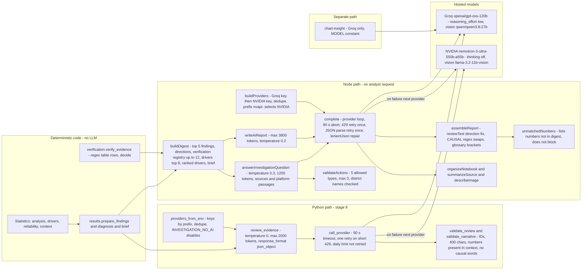
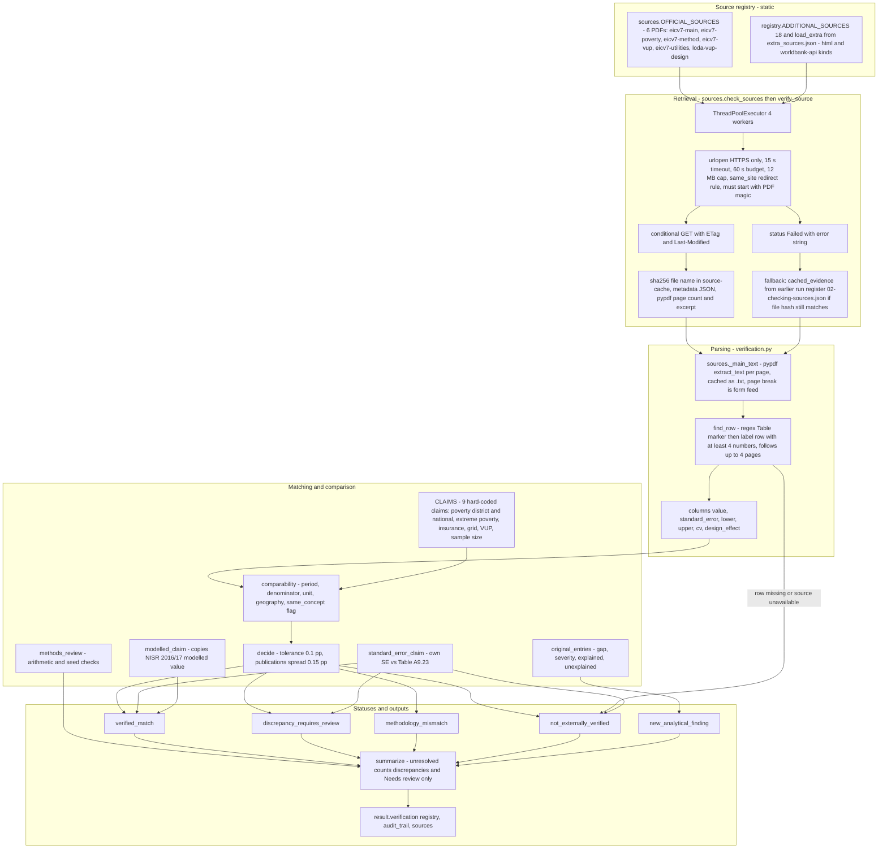
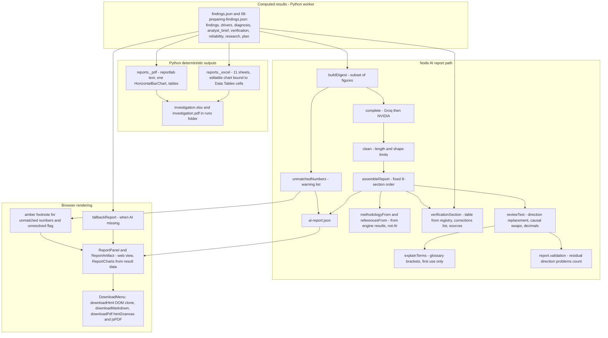
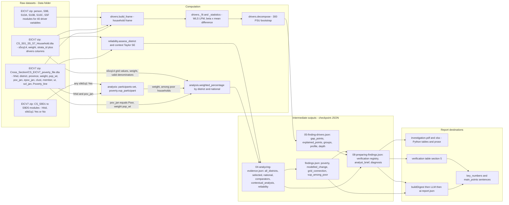
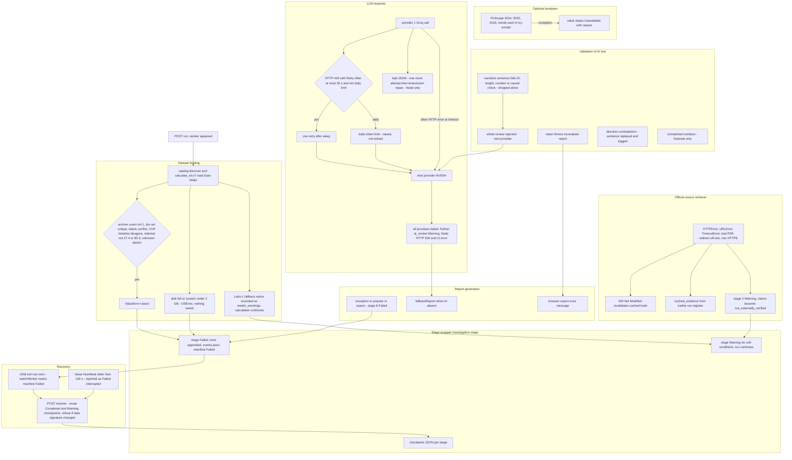

# MASTER ARCHITECTURE - Ireme Insight District Investigation Engine (current state)

Audit date 2026-10-29. Repository `D:\Project\Poverty-Analysis-Reduction`, commit `919a77e` plus uncommitted edits (Base44 files deleted, Supabase functions added). **Read-only audit; nothing was redesigned or changed.** Detailed chapters: [README](README.md). **UNKNOWN** means the evidence is missing; the gaps are listed in section 12.

## Glossary for a reader new to the codebase

| Term | Meaning |
|---|---|
| NISR | National Institute of Statistics of Rwanda, publisher of the surveys and reports |
| EICV7 | Integrated Household Living Conditions Survey, 7th round (2023/24). Source of every headline figure |
| EICV3-5 | Earlier survey rounds, used only for trend/panel views, not for headline figures |
| FinScope | Financial-inclusion survey (2012, 2016, 2020, 2024), used for the "access strand" views |
| VUP | Vision Umurenge Programme, a social-protection programme; "VUP participation" is a survey answer, not eligibility or payment |
| PSU / strata | Primary sampling unit (cluster `clust`) and sampling stratum (`strata_id`) used for variance |
| Oaxaca-Blinder | Split of the gap between a district and Rwanda into a part lined up with measured factors and a leftover part |
| Verification | Comparison of engine numbers with rows parsed from NISR PDFs (no AI) |

## 1. Executive architecture summary

1. **What it is.** A local, single-user toolchain: a React page starts a Python worker per district; the worker computes weighted EICV7 estimates, a bootstrap Oaxaca-Blinder decomposition, FinScope/trend views, checks a fixed list of claims against NISR PDFs, calls a hosted LLM once for a reference-selecting "review", and exports PDF/XLSX. A separate Node layer writes the narrative report and chat answers on request. Everything is files under `investigations/`.
2. **Where it runs.** Only inside the Vite dev server (`apply: 'serve'`, host and origin check for localhost, no authentication). No database, queue, or production deployment exists. Supabase hosts only USSD and a chart Q&A function that do not call the engine.
3. **AI.** Providers Groq `openai/gpt-oss-120b` then NVIDIA `nemotron-3-ultra-550b-a55b`, tried in order. No Ollama, no key rotation, no agents or tool loops. AI writes prose and selects references; it does not compute or verify.
4. **Statistics.** Population-weighted headcount and other rates from NISR microdata; Taylor-linearised SEs by strata/cluster; weighted linear probability model with stratified PSU bootstrap (300 draws, seed 20240117) for the decomposition; FGT gap/severity; reliability grades by relative SE.
5. **Evidence verification.** Static list of 6 official + 18 additional URLs; PDF text cached by hash; regex row extraction for 9 hard-coded claims; statuses `verified_match`, `discrepancy_requires_review`, `methodology_mismatch`, `not_externally_verified`, `new_analytical_finding`.
6. **Headline answer.** The engine has *some* independent checks (hard-coded national figures, NISR SE comparison, arithmetic identities, tests with planted drivers) but **no runtime independent re-computation**, and its evidence verification can silently reduce to near-zero when source retrieval fails while the report is still produced.
7. **Kamonyi case.** Computed figures (39.7, 27.4, 29.1, 9.2, decomposition) are all present in stored checkpoints. The "1 of 15 matches" result arose because 20 of 24 official sources failed to download; the one match is a self-comparison; the AI "sentence correction" was a false positive that added an unrelated claim.

## 2. Complete system architecture (Diagram 1)

```mermaid
flowchart TB
  subgraph UI["Browser - React (Vite dev)"]
    DI["DistrictInvestigation.jsx - start, poll 1800 ms, resume, review"]
    UAR["useAiReport.js - GET or POST ai-report"]
    RA["ReportArtifact.jsx - report view and downloads"]
    RE["reportExport.js - HTML, Markdown, PDF via html2canvas and jsPDF"]
    CH["InvestigationChat.jsx and Notebook.jsx"]
  end

  subgraph API["Vite middleware vite-api.mjs - localhost only, dev server only"]
    RT["investigationApi routes: run, resume, run-id, result, catalog, report-pdf-xlsx, ai-report, chat, notebook, sources, upload, sites, review, board"]
    WK["workers Map, resuming Set, changing Set - in-memory concurrency guards"]
  end

  subgraph PY["Python worker - tools/investigation/engine.py"]
    ENG["Investigation.run and _run - 8 checkpointed stages, OS file lock, 10 s heartbeat"]
    CAT["catalog.discover - file and variable inventory"]
    SRC["sources.check_sources - 24 registered URLs, 4 threads"]
    STAT["analysis.calculate_eicv7, context, reliability, drivers"]
    FIN["finance.py and finscope2012 2016 2020, trends.py"]
    VER["verification.verify_evidence"]
    RES["results.py, diagnosis.py, brief.py, problem_profile.py, provenance.py"]
    AIPY["ai.review_evidence - LLM reference selector"]
    REP["reports.export_reports - PDF via reportlab, XLSX via xlsxwriter"]
  end

  subgraph NODE["Node LLM layer - inside Vite process"]
    LLM["llm.mjs complete - provider order Groq then NVIDIA"]
    AIR["ai-report.mjs buildDigest, writeAiReport, unmatchedNumbers"]
    TPL["reportTemplate.js assembleReport, reportChecks.js reviewText, reportVerification.js"]
    AIC["ai-chat.mjs answerInvestigationQuestion, validateActions"]
    AIN["ai-notebook.mjs organizeNotebook"]
    WEB["web-source.mjs, site-index.mjs, data-platform.mjs, browser-render.mjs"]
  end

  subgraph DATA["Local data - Data folder"]
    E7["EICV7 2023-24 zip and VUP zip"]
    EH["EICV3-4 panel, EICV4 and EICV5 zips"]
    FS["FinScope 2012 sav, 2016 sav, 2020 zip, 2024 dta"]
  end

  subgraph STORE["investigations folder - JSON files, no database"]
    RUNS["runs by id: manifest, stage JSON 01 to 08, events.jsonl, lease, findings, action-plan, ai-report, chat, investigation.pdf and xlsx"]
    CACHE["cache: catalog by data signature, data-platform catalog, crawled sites"]
    SC["source-cache: NISR PDFs by sha256, text extracts, metadata JSON"]
    TR["trash: deleted runs, recoverable"]
  end

  subgraph EXT["External services"]
    NISR["statistics.gov.rw EICV7 PDFs and HTML pages"]
    OTH["LODA, World Bank API, DHS, WFP, FAO, UNDP, UNICEF, ministries and others"]
    DGR["api.data.gov.rw catalogue"]
    GROQ["Groq - openai/gpt-oss-120b"]
    NV["NVIDIA - nemotron-3-ultra-550b-a55b"]
    ANY["Analyst-supplied websites and uploaded files"]
  end

  subgraph SB["Supabase - NOT connected to the engine"]
    CI["functions/chart-insight - Groq only"]
    US["functions/ussd"]
  end

  DI --> RT
  UAR --> RT
  CH --> RT
  RA --> RE
  RT --> WK
  RT -->|spawn detached child| ENG
  ENG --> CAT --> E7
  CAT --> EH
  CAT --> FS
  ENG --> SRC --> NISR
  SRC --> OTH
  SRC --> SC
  ENG --> STAT --> E7
  ENG --> FIN --> FS
  FIN --> EH
  ENG --> RES
  ENG --> VER
  VER --> SC
  ENG --> AIPY --> GROQ
  AIPY --> NV
  ENG --> REP
  ENG --> RUNS
  CAT --> CACHE
  RT --> AIR
  RT --> AIC
  RT --> AIN
  AIR --> LLM
  AIC --> LLM
  AIN --> LLM
  LLM --> GROQ
  LLM --> NV
  AIR --> TPL
  WEB --> ANY
  WEB --> DGR
  RT --> WEB
  AIR --> RUNS
  RT --> RUNS
  RT --> TR
  CI -.->|separate path, not engine| GROQ
```

Layers: browser (`src/pages/DistrictInvestigation.jsx`), Vite middleware (`tools/investigation/vite-api.mjs`), Python worker (`tools/investigation/engine.py`), Node LLM layer (`llm.mjs`, `ai-report.mjs`, `ai-chat.mjs`), data (`Data/`), file store (`investigations/`). Detail: [01](01-current-system-architecture.md).

## 3. End-to-end execution sequence (Diagram 2)

Key facts: entry `POST /__local/investigations/run`; district validated against `src/data/dashboard-eicv7-aggregates.json`; progress via `manifest.json`, `events.jsonl`, 10 s lease heartbeat, UI polling every 1.8 s; eight stages named `Discovering Data` to `Preparing Findings`; **source failures only warn; no stage blocks report creation**. Detail: [02](02-investigation-workflow.md).

## 4. Statistical processing architecture (Diagram 3)

Detail and the list of what is *not* implemented (no design effects for the decomposition, no replicate weights, no nonlinear decomposition): [03](03-statistical-engine.md).

## 5. AI orchestration architecture (Diagram 4)

Seven call sites (Python reviewer, report writer, chat, notebook, source/image summaries, chart Q&A, key check). Validators differ per site; the strictest is the Python reviewer, the loosest are chat and notebook (numbers flagged only). Detail: [04](04-ai-orchestration.md).

## 6. External evidence verification architecture (Diagram 5)

Detail, including the circular modelled-claim match and the cache fallback gap: [05](05-evidence-verification.md).

## 7. Report-generation architecture (Diagram 6)

Three independent builders (Python PDF/XLSX without AI or verification, Node AI report with verification section, browser exports). Detail: [06](06-report-generation.md).

## 8. Data lineage (Diagram 7)

Five indicators traced in [07](07-data-lineage.md): district poverty (`pov_jan`, `pop_wt`), national poverty (same, hard-gated at 27.4), electricity (`s5cq14`), VUP (`s9d1q1` in five S9D modules among poor households), Oaxaca-Blinder contribution (`drivers.decompose`).

## 9. Error handling (Diagram 8)

Detail: [08](08-error-handling.md). Not implemented: automatic retries of a run, alerting, circuit breakers, blocking on unverified evidence.

## 10. Component inventory summary

50 components catalogued in [09](09-component-inventory.md): 40 implemented and confirmed, 1 partial (`variable_checks.py`, test-only), 7 not implemented (official-publication discovery, Excel retrieval, key rotation, Ollama, database/queue, approval workflow, runtime independent recomputation), 1 referenced but not found (Base44 backend), 1 unknown (production hosting).

Core implemented components: `engine.Investigation`; `analysis.calculate_eicv7`; `context.design_variance`; `reliability.assess_district`; `drivers.decompose` and `consumption_view`; `finance`, `finscope2012/2016/2020`, `trends`; `sources.check_sources`; `verification.verify_evidence`; `ai.review_evidence`; `llm.complete`; `ai-report.writeAiReport`; `reportTemplate.assembleReport`; `reportChecks.reviewText`; `reports.export_reports`; `vite-api.investigationApi`.

## 11. Critical weaknesses

| ID | Severity | Weakness |
|---|---|---|
| W1 | Critical | The single "verified match" in Kamonyi is a copy of the NISR value into both fields (`verification.py:289-292`) yet it drives the headline "1 of 15 match" |
| W2 | Critical | Report/PDF produced after 20 of 24 official sources failed; `unresolved: 0` because only discrepancies count; export has a warning prop only |
| W3 | High | `reportChecks.reviewText` flagged a true VUP sentence (the pattern for "poor households" also means poverty) and replaced it with a two-claim sentence (reproduced offline) |
| W4 | High | `unmatchedNumbers` is a footnote; "never say verified" is prompt-only; the Python number check is context-wide, not per-claim |
| W5 | High | `verify_source` fallback ignores `source-cache/<id>.json`; a valid cached `eicv7-main` PDF went unused |
| W6 | High | No runtime second implementation; only hard-coded 27.4/85.3, one SE check (needs a live PDF), arithmetic identities |
| W7 | High | Definition equivalence is hand-flagged; grid never verifies, VUP has no comparator |
| W8 | High | Taylor SE (no FPC, normal limits) and decomposition inference not corroborated beyond the poverty SE |
| W9-W17 | Medium/Low | Provider inconsistency, narrative non-reproducibility, citations of failed sources, digest omits reliability grades, scale-out limits, poor auditability, no authentication, doc drift, unstaged steps |

Full register with code evidence and the ten focus-question answers: [10](10-architectural-weaknesses.md).

**Direct answers.** Independent statistical verification at runtime: **No**. Independent evidence verification: **Partly** (deterministic and non-AI, but a fixed claim list and brittle when sources fail). Critical paths that bypass validation: **Yes** - source failure to report/export (W2); self-referential verified match (W1); AI narrative numbers outside the Python reviewer (W4).

## 12. Questions requiring further investigation

Full list in [12](12-open-questions.md). Highest value first:

1. Raw LLM prompts/responses and the reason both providers failed in stage 8 (not stored).
2. Whether earlier run registers existed at 18:55Z (cache fallback), and the contents of the three trashed Kamonyi runs.
3. A re-run of `calculate_eicv7` and `decompose` to prove numeric reproducibility (not done here).
4. NISR design-based SEs for VUP, grid and insurance to test the Taylor approximation.
5. Sensitivity of the Oaxaca-Blinder shares to the reference coefficients and to a logit specification.
6. Intended production topology (the only API is a dev-server plugin).

## Evidence base of this audit

Code read in full: `engine.py`, `analysis.py`, `drivers.py`, `context.py`, `reliability.py`, `verification.py`, `sources.py`, `ai.py`, `results.py`, `reports.py`, `vite-api.mjs`, `llm.mjs`, `ai-report.mjs`, `ai-chat.mjs`, `reportChecks.js`, `reportVerification.js`, `reportTemplate.js`, `reportData.js`; outlines of the remaining modules. Stored artifacts: Kamonyi run `1d3f9adc-17ba-44ba-b52a-56597f243a69`. Tests run: Node 41/41 pass; `test_verification` 27/27 pass. Mermaid diagrams were validated with a structural linter, not the official parser (see README).
