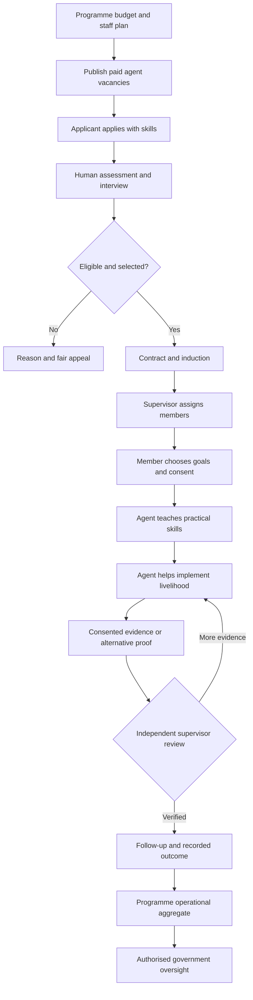
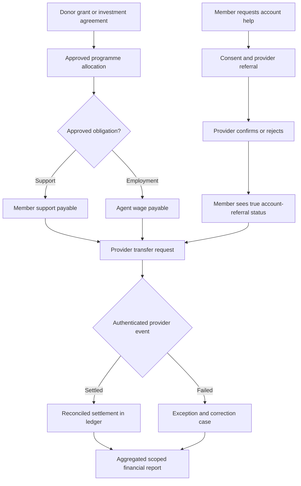

# End-to-End Workflows (Mermaid)

## Opportunity-to-livelihood

## Finance and inclusion

## Evidence-to-action with the existing AI Engine

```mermaid
flowchart LR
    A[Published NISR statistics] --> B[Existing AI Engine investigation]
    B --> C[Verified aggregate finding or restricted draft]
    C --> D[Scoped human action request]
    D --> E[Programme manager accepts and assigns]
    E --> F[Agent practical training and implementation]
    F --> G[Independent field verification]
    G --> H[Programme outcome monitoring]
    H --> I[Operational report with source status]
```

**Rule:** a restricted AI Engine draft cannot become an official claim simply because it was copied to an operational report.
