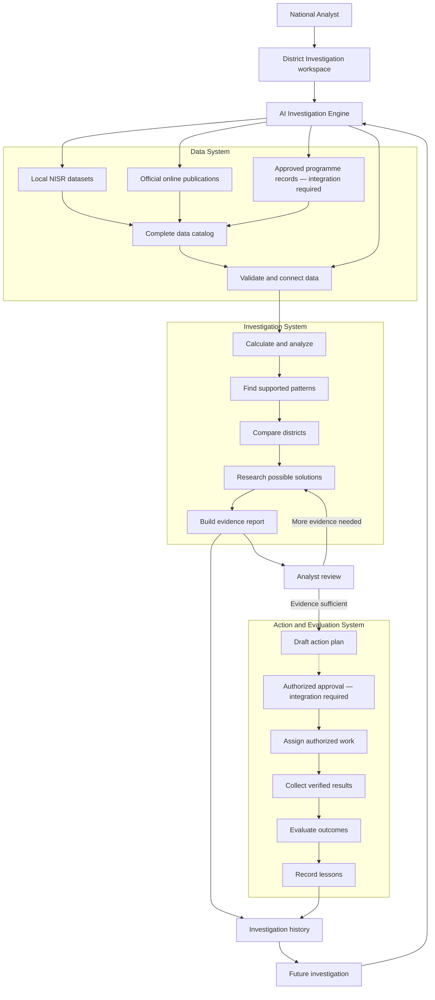

# District Investigation

## Purpose

District Investigation is the analyst-facing workflow for traceable district evidence work in NISR Track 2. It starts with a district selection, inventories the configured local data, retrieves a small allowlist of public official publications, validates compatible data relationships, calculates supported aggregate measures, and prepares reviewable findings.

The current first implementation starts with Gisagara but uses the selected district name from EICV7 data rather than district-specific code. It is designed to support repeat investigations while preserving prior outputs and dataset versions.

This document interprets the supplied architecture diagram as a logical system design. It does not treat the diagram as an authorization or data-access rule.

## Architecture



## Current implementation

### History and live progress

The investigation page displays the worker's actual stage list, including Finding Drivers for new runs. Progress counts completed, warning and skipped stages; it is not a time estimate. Older saved runs keep their original stage lists. Counts, current work, warnings, errors and recent activity come from the saved worker state.

History supports individual checkboxes, Select all saved investigations, and per-row deletion. A confirmation dialog lists the scope before deletion. `DELETE /__local/investigations/history` accepts batches of up to 200 UUIDs and returns separate `deleted` and `skipped` lists. Pending/running workers and runs being resumed or reviewed cannot be removed. Requests retain the localhost and same-origin checks.

Deletion moves each saved run directory into `investigations/trash/<run-id>-<unique-id>/`. Reports and local review notes remain recoverable there but are no longer listed or served through run endpoints. There is no restore button yet. Original `Data/` files, shared catalog caches and verified source copies are unaffected. Deletion is available through the local worker; a static production build still needs its documented investigation service integration.

The investigation engine is implemented in `tools/investigation/`.

| Component | Current responsibility |
| --- | --- |
| `catalog.py` | Scans CSV, XLSX, SAV, DTA, JSON, Parquet, and supported archive members. Records files, tables, variables, types, labels, missing values, geographic fields, weights, relationships, access restrictions, classifications, and failures. |
| `sources.py` | Retrieves only HTTPS PDFs from an institutional allowlist, records original URL, publisher, data period, methodology, version hash, retrieval time, status, and failure details. |
| `drivers.py` | Decomposes a district's gap to Rwanda into measured factor groups (weighted linear probability model, Oaxaca-Blinder split, stratified PSU bootstrap with 300 replicates and a fixed seed), profiles who is poor, measures poverty depth and severity, and compares the unexplained gap across all districts. |
| `diagnosis.py` and `knowledge.py` | Rank drivers, grade the evidence, attach reviewable mechanism hypotheses, response families to research and linked sources, and generate open research requests and external cross-checks. |
| `registry.py` | Declares every registered source with a trust tier. Analysts can add sources in `extra_sources.json`. |
| `analysis.py` | Produces aggregate EICV7 estimates after same-survey ID and district checks. It does not export household records. |
| `results.py` | Produces traceable, cautious findings, research options, a draft plan, and an evaluation state. |
| `ai.py` | Optional Groq review receives aggregate evidence only. Output is limited to known evidence references and research-question IDs; missing configuration is explicitly Skipped. |
| `reports.py` | Produces aggregate-only Excel and PDF investigation reports. |
| `engine.py` | Coordinates checkpoints, events, reproducibility signatures, history, safe retries, and result persistence. |
| `vite-api.mjs` | Provides the local development API used by the frontend for starting, observing, resuming, reviewing, and exporting an investigation. |

The workspace displays these persisted stages:

1. Discovering Data
2. Checking Sources
3. Connecting Datasets
4. Analyzing Evidence
5. Finding Drivers
6. Comparing Districts
7. Reviewing Solutions
8. Preparing Findings

Each stage has `Pending`, `Running`, `Completed`, `Warning`, `Failed`, or `Skipped` status. Counts, filenames, source titles, warnings, errors, and checkpoints come from real operations. A resume reuses completed checkpoints and retries an incomplete or failed stage without replacing the original investigation ID.

## Data inventory and classification

Every discovered file and every readable variable is catalogued even when it is not used in the initial Gisagara analysis. The catalog records:

- filename, archive member, format, source statement, inferred survey identity and period
- table or sheet name, row count, version hash, potential within-survey ID relationships
- column name, variable label, data type, missing-value count, possible weight and geography markers
- access restriction and one of these classifications: `Used`, `Relevant but unavailable`, `Not comparable`, `Requires processing`, `Unreliable`, `Not relevant`, or `Restricted`
- an explanation for the classification, including recorded reader and archive failures

The classification is an analytical-use decision. It does not imply that a variable is unimportant or that it is safe to disclose.

## Data relationships and statistical methods

The current calculation supports compatible EICV7 cross-section measures only. It validates unique household identifiers and matching household geography before matching EICV7 household, person, poverty, and VUP modules. It never joins records across EICV survey rounds or with FinScope solely by district.

The implemented Gisagara outputs are:

| Measure | Unit and denominator | Current use |
| --- | --- | --- |
| Poverty | population-weighted percentage of people classified `Poor` | primary district outcome |
| Extreme poverty | population-weighted percentage of people classified `Extreme Poor` | supporting condition |
| VUP participation | household-weighted percentage of surveyed poor households reporting a participant in a VUP component | context only; not eligibility, payment receipt, all social support, or programme performance |
| Grid connection | household-weighted percentage reporting an electricity-grid connection | living-conditions context |
| Health insurance | person-weighted percentage reporting current health insurance | health context |

The engine checks that its national EICV7 poverty and health-insurance estimates reconcile to the published benchmark values before it publishes district outputs. It does not infer causation from district gaps.

Older EICV poverty values are not directly subtracted from EICV7 values because NISR changed the poverty methodology. The engine uses the published EICV7-method modelled 2016/17 comparison only when it is retrievable and agrees with the EICV7 district estimate. It labels that comparison as modelled-to-observed and retains its limitations.

District comparisons select up to three same-province districts nearest in observed EICV7 poverty. This is a descriptive comparison rule. It does not establish that the districts have similar rurality, livelihoods, programme delivery, or transferable solutions.

## Driver analysis

Drivers answer what lines up with a district's poverty, not what proves it. Each factor group's contribution is its national coefficient multiplied by the district-minus-national difference in that factor, so contributions plus the unexplained remainder equal the gap exactly. Grades: Strong (95% interval excludes zero, sign holds in 95% of replicates, at least 1 point), Moderate, Not established. Housing, phone and internet factors are shown as signs of deprivation because poverty also causes them. Every driver carries a mechanism hypothesis, what would confirm it and response families to research; none is a recommendation. Poverty depth reproduces NISR's poor classification for every household before use. The place-effect view shows whether neighbouring districts share the unexplained gap (a regional factor) or not (a local one). The Research Requests list records evidence gaps and feeds the analyst's "Request further research" decision. Checkpoints for stage 8 are saved as `08-preparing-findings.json`; earlier runs used stage 7.

## Official source register

The source checker retrieves every registered source on each run. The six NISR/LODA PDFs below can support calculations and findings. Additional government, multilateral and evidence-library sources (including the World Bank API used to cross-check the national poverty rate) are listed in [OFFICIAL_SOURCE_REGISTER.md](OFFICIAL_SOURCE_REGISTER.md) and the README with their trust tier:

| Publisher | Source type | Intended use |
| --- | --- | --- |
| National Institute of Statistics of Rwanda | EICV7 Main Indicators Report | published district and national indicators and sampling uncertainty |
| National Institute of Statistics of Rwanda | EICV7 Poverty Profile | method-adjusted historical comparison |
| National Institute of Statistics of Rwanda | EICV7 Methodological Note | interpretation and comparability limits |
| National Institute of Statistics of Rwanda | EICV7 VUP Thematic Report | programme context only |
| National Institute of Statistics of Rwanda | EICV7 Utilities and Amenities Thematic Report | utilities context only |
| Local Administrative Entities Development Agency | Vision Umurenge Programme document | historical programme design; no current outcomes or district effectiveness inferred |

For every retrieval, the source register stores the original URL, publisher, document title, data period, stated geographic coverage, measurement definition, methodology, retrieval time, content hash, page count when readable, limitations, and an explicit completed or failed status. A report publication date is not treated as the data period. Retrieval uses TLS validation and does not bypass a failed certificate or an access restriction.

Additional official publishers can be registered only after their endpoint, methodology, access terms, and intended use are reviewed. Public web content is treated as untrusted reference material and cannot direct application behavior or approve actions.

## Gisagara workflow

1. A National Analyst chooses Gisagara and starts a run.
2. The engine computes a signature of all configured local data files and creates a unique investigation ID.
3. It builds or reuses a catalog for that unchanged file signature, preserving every recorded table, variable, failure, and skip.
4. It checks allowlisted official sources and retains each retrieval result.
5. It validates the EICV7 cross-section relationships needed for supported measures.
6. It calculates eligible aggregate EICV7 measures and selects descriptive same-province comparators.
7. It prepares findings with survey period, unit, denominator, source, uncertainty or limitation, evidence strength, and next step.
8. It prepares research options only when an official source supports programme context. Options remain research options, not automatic recommendations.
9. It writes an evidence report, a draft action plan, and an evaluation record with status `Awaiting approved action and verified follow-up`.
10. The analyst can save a review decision: accept a finding, request deeper investigation, reject an interpretation, flag a conflict, or request more data.

Repeated runs retain their own source versions and data signature. A later run records changes against the immediately previous run for the same district. An unchanged input set should reproduce the same calculation outputs; a new local file changes the signature and produces a new catalog for a new investigation.

## Analyst review, action, and evaluation

The engine may identify evidence and create a draft only. It cannot create a payment, enrol a beneficiary, assign operational work, or approve an action.

The current app uses local demo roles. Those roles are useful for frontend routing but do not establish trusted server-side role, territory, programme, or data access. The local API therefore rejects `approve`, `act`, and `follow-up` requests until a trusted server-side authorization system and Action Center integration are available.

When those integrations exist, the required workflow is:

1. Analyst reviews the evidence and records a decision.
2. An authorized decision-maker approves or revises the draft.
3. Permitted users receive linked work items.
4. Verified activity and follow-up data are recorded against the investigation.
5. Evaluation distinguishes completed work, households reached, services accessed, and outcome measures.
6. A before-and-after change is not treated as evidence that an action caused poverty reduction.

## Data protection

The engine limits investigation outputs to aggregate results. It does not put household identifiers, personal identifiers, health details, financial account details, or beneficiary records in chart context, findings, reports, or local review notes.

Potential record keys are classified as `Restricted`. A later authorized implementation must enforce role, programme, geographic, and purpose restrictions on the server before it exposes protected data or prompts an AI provider with any sensitive information.

## Reports

The report exporter produces an aggregate-only workbook with these worksheets:

- Investigation Summary
- Verified Findings
- Data Tables
- Editable Charts
- District Comparisons
- Action Plan
- Sources and Methodology
- Limitations

The editable Excel chart references exported worksheet cells. The PDF uses the same persisted findings, comparison, source, limitation, action, and evaluation data. Neither report includes household-level records.

## Test plan

The test module `tools/investigation/test_investigation.py` covers catalog discovery across supported formats, catalogued unsupported files, historical comparability and identifier classifications, source allowlist and failure recording, detected conflicting figures, weighted missing-data behavior, checkpoint reuse and retry, data-signature changes, and aggregate report structure.

Before release, run the following and record the exact results:

```powershell
.\.venv\Scripts\python.exe -m unittest tools.investigation.test_investigation -v
npm run lint
npm run typecheck
npm run build
```

Manually verify the full Gisagara scenario in the intended local environment: start a run, observe persisted events, inspect the catalog, open both report formats, save an analyst review note, confirm the operational endpoints reject unauthorized writes, reopen history, repeat with unchanged data, then add a valid local file and confirm it produces a new catalog signature. Repeat the calculation for another EICV7 district without altering analytical code.

## Current limitations and integration boundaries

The executed results, rather than the test plan above, are recorded in [INVESTIGATION_TESTING.md](INVESTIGATION_TESTING.md) and `investigation-verification.json`. The actual catalog contains 16 supplied files, 315 table/archive entries, and 15,988 variables. One unreadable SAV and two archive metadata entries are retained explicitly. [DATA_INVENTORY.md](DATA_INVENTORY.md) lists the files; [GISAGARA_INVESTIGATION.md](GISAGARA_INVESTIGATION.md) records computed findings.

The worker saves file hashes, source hashes, Python/package versions, implementation signatures, stage checkpoints and a heartbeat. OS file locks prevent concurrent workers from overwriting the same run. Unchanged files can reuse their catalog metadata when a new dataset is added. A new run rechecks the registered official publications; conditional HTTP checks can reuse unchanged content. Failed update checks remain failed even when an independently verified cached document is available.

- The local data directory is available only to the local development workflow. A deployed investigation service needs an approved secure data store and a server-side processing boundary.
- The supplied FinScope and older EICV data are catalogued, but their district measures are not calculated until variable definitions, denominators, weights, and comparability are validated.
- The engine currently uses a deliberately small source allowlist. A failed retrieval remains a recorded failure and cannot be represented as verified evidence.
- Not every district measure has an extracted design-adjusted confidence interval in the current calculation. Findings state whether uncertainty is available.
- A narrative figure can differ from a published table or reproduced microdata estimate. Such disagreements are kept as source conflicts for analyst review rather than silently resolved.
- Research options describe possible investigations; they do not supply budgets, effectiveness claims, feasibility determinations, or programme enrolment recommendations without verified evidence.
- The AI provider is optional and not needed for the deterministic data, validation, and calculation stages. If configured later, it must receive only minimized, source-grounded aggregate context and its output must remain reviewable.
- Trusted RBAC, Action Center work-item creation, programme-record integration, and verified follow-up collection need server-side authorization and integration work before operational use.

